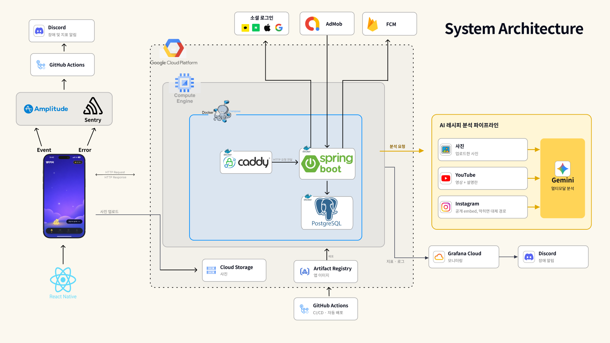
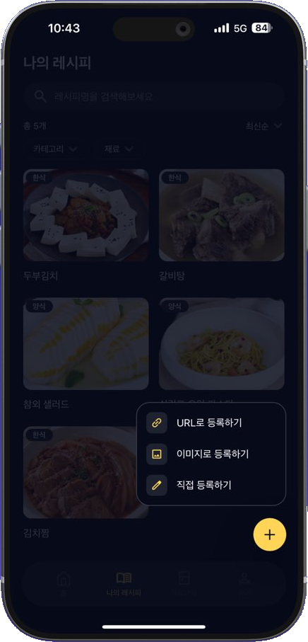
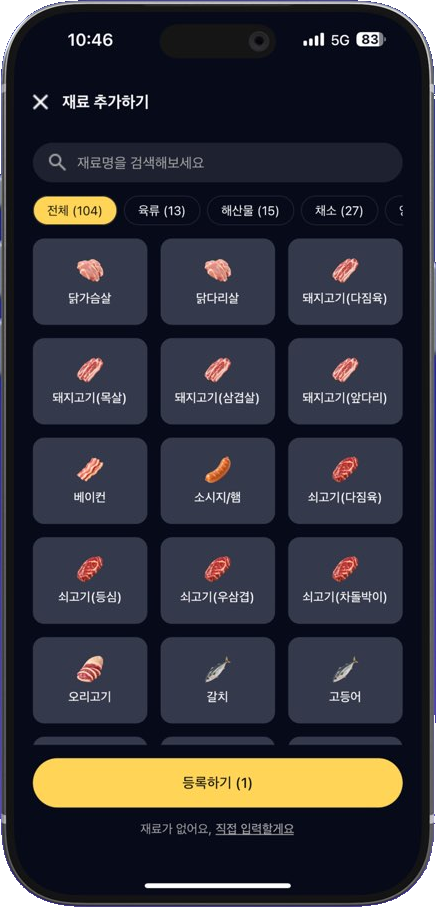
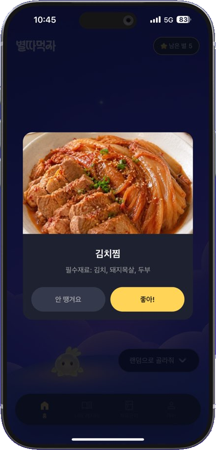

# 별따먹자 (StarPick) Backend

YouTube, Instagram 레시피 저장부터 오늘 뭐 먹지 추천까지 돕는 레시피 앱 서비스입니다.



> GCP 운영 구조 — GCE Docker Compose(Caddy, Spring Boot, PostgreSQL), Gemini 분석, Grafana Cloud 관측

## 1. 프로젝트 배경

YouTube, Instagram에 흩어진 레시피는 저장해도 다시 쓰기 어렵고, 매번 메뉴를 새로 고민하는 문제가 있었습니다.

링크나 사진을 AI로 분석해 저장하고, 랜덤 또는 보유 재료 기준 추천으로 메뉴 고민을 줄이도록 기획하고 개발했습니다.

- **기간**: 2026.08 ~ 2026.10 (2026.09 앱 출시)
- **소속**: SWYP 앱 6기 2팀
- **팀 구성**: PM 2 / Designer 3 / Frontend 1 / Backend 2

## 2. 주요 기능

- **레시피 저장**: YouTube, Instagram 링크나 사진을 올리면 **AI가 레시피 초안을 생성**, 직접 입력도 지원
- **메뉴 추천**: 저장한 레시피 중 오늘 메뉴를 **랜덤 또는 보유 재료 기준으로 추천**
- **재료 관리**: 보유 재료를 등록하고 추천 조건으로 사용
- **조리 기록**: 요리를 마칠 때마다 기록하고 레시피별 횟수와 이력 확인
- **식사 알림**: 사용자가 정한 요일, 시각에 **리마인드 푸시 알림**
- **게스트와 광고**: 가입 없이 둘러보기, 저장 한도를 넘으면 **보상형 광고로 저장 슬롯 확장**


| 레시피 저장                                                           | 보유 재료 등록                                                                 | 랜덤 추천                                                             |
| :----------------------------------------------------------------: | :------------------------------------------------------------------------: | :-----------------------------------------------------------------: |
|  |  |  |


## 3. 기술 스택


| 영역         | 기술                                                                            |
| ---------- | ----------------------------------------------------------------------------- |
| Backend    | Java 25, Spring Boot 4.1, Spring Security, JPA, Flyway, PostgreSQL 18, JWT    |
| External   | Gemini API, YouTube Data API, FCM, AdMob, 소셜 로그인(Kakao, Google, Naver, Apple) |
| Infra      | GCE, Docker Compose, Caddy, Cloud Storage, Artifact Registry, GitHub Actions  |
| Monitoring | Grafana Cloud, Alloy, Discord 알림                                              |
| Test       | JUnit, Testcontainers(PostgreSQL), k6                                         |


## 4. 협업


| 이름  | 역할       | GitHub                                                   | 담당                                                                         |
| --- | -------- | -------------------------------------------------------- | -------------------------------------------------------------------------- |
| 김민석 | Backend  | [@g1ennk](https://github.com/g1ennk)                     | 레시피, AI 분석, 알림 API, GCP 서버 운영                                              |
| 허예진 | Backend  | [@Heo-YJ](https://github.com/Heo-YJ)                     | 인증, 회원, 재료, 추천, 광고 API, CI/CD                                              |
| 이승환 | Frontend | [@Leeseunghwan7305](https://github.com/Leeseunghwan7305) | [React Native 앱](https://github.com/swyp-app-6-team-2/frontend) 개발, 스토어 출시 |


- 매주 금요일 정기 회의로 진행 상황을 공유하고 직군별 요구사항을 조율
- 기획, 디자인, 개발이 함께 QA: 문제 발견 → 원인 확인 → 수정 및 재검증
- Discord(소통·QA 제보), Figma(디자인), Notion(문서), GitHub(개발)

## 5. 주요 기술 결정

### 1) [별도 큐 없이 DB 작업 테이블로 AI 레시피 분석 비동기 처리](docs/wiki/ingestion-async-queue.md)

- **[문제]** 분석이 수 초에서 20여 초 걸려, 요청 안에서 **동기로** 처리하면 **연결이 끊길 때 결과를 받을 수 없고 재시작하면 요청이 유실됨**
- **[해결]** 요청은 작업만 저장하고 바로 응답, Worker가 **비동기로** 분석하며 **SKIP LOCKED**로 선점, 멈춘 작업은 주기적으로 복구
- **[결과]** 요청은 **prod 평균 63ms에 응답**, 멈춘 작업은 **재처리하거나 실패로 알려 유실 없음**(PostgreSQL 통합 테스트)

<!-- 예진 님 작성: 기술 결정 항목 추가 (제목 링크 + [문제] / [해결] / [결과]) -->

## 6. 주요 트러블슈팅

### 1) [0/6→6/6: Instagram 음원 릴스 분석 실패를 3단계 수집 경로로 해결](docs/wiki/instagram-music-reel-fallback.md)

- **[문제]** QA에서 다른 입력은 성공했지만 **Instagram 음원(배경음악) 릴스 6개는 모두 실패**
- **[해결]** 성공한 릴스와 응답을 비교해 **음원 릴스만 영상 주소가 없음**을 찾고, 공개 embed → 외부 수집 API → 캡션과 대표 이미지 순서의 **3단계 수집 경로**를 둠
- **[결과]** **실패하던 음원 릴스 6개가 모두 성공**(로컬, dev, prod)

### 2) [레시피 목록 API p95 1,107ms→138ms: 순차 이미지 URL 서명을 부하테스트 후 가상 스레드로 병렬화](docs/wiki/recipe-list-parallel-url-signing.md)

- **[문제]** 레시피 목록이 운영 모니터링에서 **가장 느린 API**였고, dev 부하테스트에서도 커버 20장 페이지 기준 **서버 p95 1.1초**로 담당 API 중 가장 느림
- **[해결]** 항목 수별 측정과 스레드 덤프로 이미지 URL 서명(원격 호출)을 **순차로 처리하는 것이 원인**임을 확인하고, **가상 스레드로 동시에 서명**
- **[결과]** 같은 데이터, 거의 같은 요청률로 dev에서 재측정해 **서버 p95 1,107 → 138ms로 개선(8배)**

<!-- 예진 님 작성: 트러블슈팅 항목 추가 (제목 링크 + [문제] / [해결] / [결과]) -->

## 7. 프로젝트 구조

```txt
backend/
├── src/main/java/.../starpick/
│   ├── domain/      # recipe, cooking, ingredient, ingestion, notification,
│   │                #   upload, inquiry, auth, user, ad
│   └── global/      # 공통 응답, 예외, 보안, 설정
├── src/main/resources/db/migration/  # Flyway 스키마
├── deploy/          # VM 구성 (Caddy, Alloy, Grafana 대시보드, 백업)
├── docs/            # 도메인 명세(specs), 기술 위키(wiki)
└── load-test/       # k6 부하테스트
```

